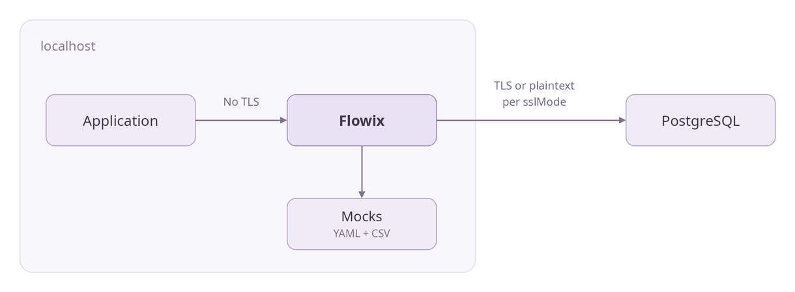
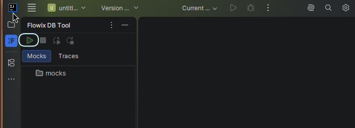
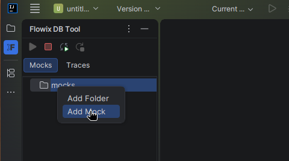
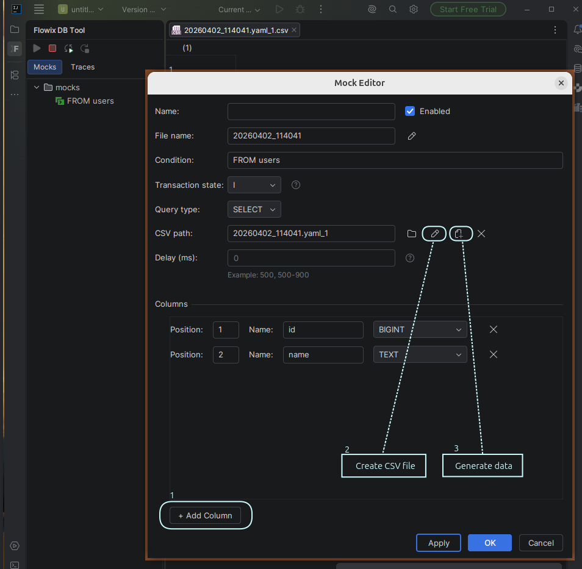
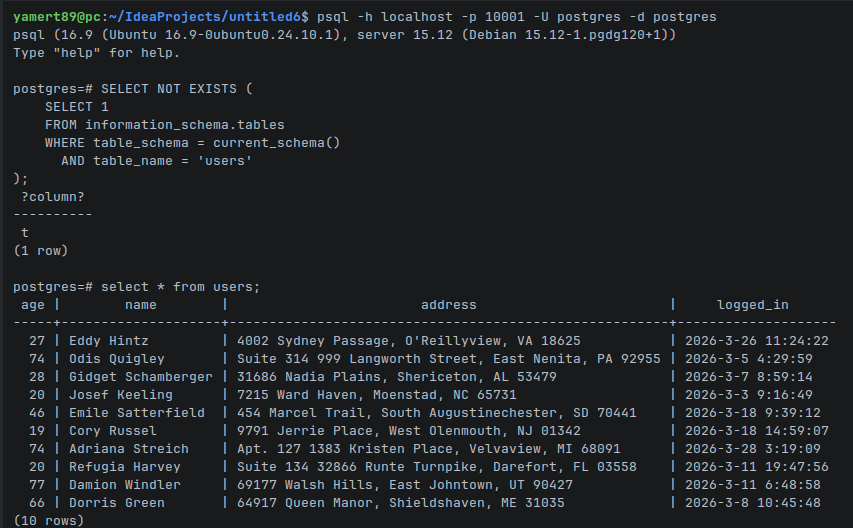
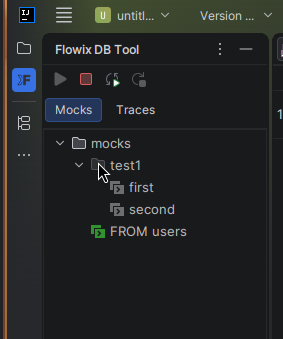
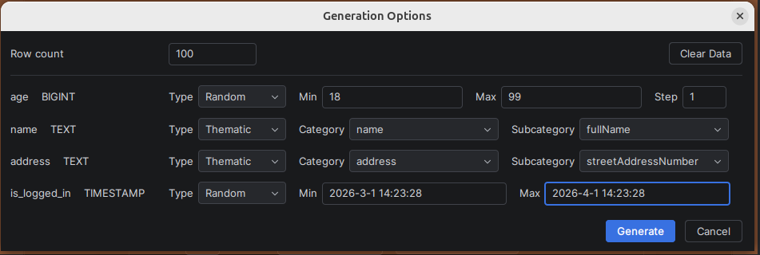
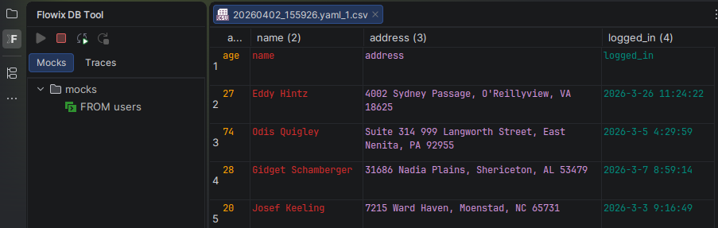
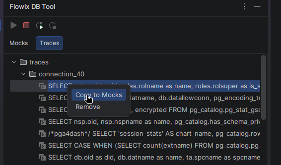
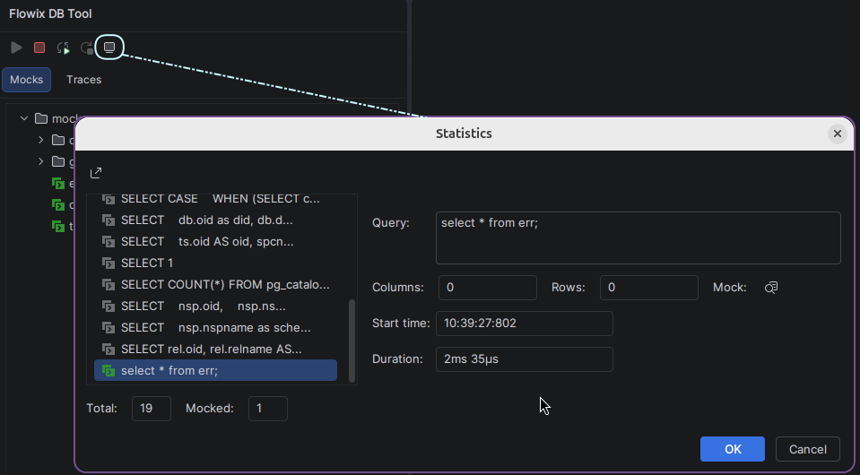

# Flowix DB Tool - Getting Started Guide

Welcome to Flowix DB Tool! This guide will help you get up and running with the plugin quickly.

## Table of Contents

1. [First Launch & Configuration](#first-launch--configuration)
2. [TLS Configuration](#tls-configuration)
3. [Starting the Server](#starting-the-server)
4. [Creating Your First Mock](#creating-your-first-mock)
5. [Check Interception Result](#check-interception-result)
6. [SQL Pattern Matching](#sql-pattern-matching)
7. [Enable/Disable](#enabledisable)
8. [Data Generation](#data-generation)
9. [SQL Tracing](#sql-tracing)
10. [Query Statistics](#query-statistics)
11. [Performance Optimization](#performance-optimization)
12. [File Locations](#file-locations)

---

## First Launch & Configuration

After installing the plugin and opening a project, Flowix DB Tool automatically initializes itself.

### Accessing the Tool Window

The Flowix DB Tool window appears on the left side of your IDE. If you don't see it:

1. Go to **View** → **Tool Windows** → **Flowix DB Tool**
2. Or use the sidebar icon

### Initial Configuration

On first launch, Flowix creates a configuration file at `.flowix/flowix.yaml` in your project root:

```yaml
schemaVersion: 2

database:                   
  host: "localhost"         # PostgreSQL host          
  port: 5432                # PostgreSQL port   
  sslMode: prefer           # TLS mode for the connection from Flowix to PostgreSQL
  # sslRootCert: /home/user/.postgresql/root.crt  # Absolute path to a PEM CA file; required for verify-ca and verify-full

flowix:
  localPort: 10001          # Port for the Flowix backend         
  managePort: 7777          # Port for communication between IDE plugin and backend
  autonomousMode: false     # Run Flowix without a real database; all data must be provided via mocks (experimental)
  logLevel: INFO            # Log level for the backend process (FINEST, INFO, SEVERE, OFF)
  csvLoading: eager         # eager: load CSV into memory; streaming: read CSV during each query
  # maxHeapSize: 512         # Optional backend Java heap limit in MB (JVM -Xmx)
  tracing:
    includeFilters: []      # SQL patterns to include in tracing; take priority over excludeFilters
    excludeFilters: []      # SQL patterns to exclude from tracing
```

---

## TLS Configuration

Configure TLS for the connection **from Flowix to PostgreSQL** in the `database` section of `.flowix/flowix.yaml` using `sslMode`.



Available modes:

| Mode | Behavior |
|------|----------|
| `disable` | Connect without TLS. |
| `prefer` (default) | Try TLS and fall back to an unencrypted connection if TLS negotiation fails or the server does not support TLS. The server certificate is not verified. |
| `require` | Require TLS without verifying the server certificate. Fail if TLS cannot be established. |
| `verify-ca` | Require TLS and verify the server certificate chain using the configured CA certificates. |
| `verify-full` | Perform the same checks as `verify-ca` and also verify that `database.host` matches the server certificate. |

For example, update the existing `database` section to require TLS with certificate and hostname verification:

```yaml
database:
  host: "db.example.com"
  port: 5432
  sslMode: verify-full
  sslRootCert: /home/user/.postgresql/root.crt
```

For `verify-ca` and `verify-full`, `sslRootCert` is required and must be an **absolute path** to a readable PEM file containing trusted CA certificates. With `verify-full`, use the database hostname listed in the server certificate. The `sslRootCert` setting is ignored by the other TLS modes.

Connections **from your application to Flowix** remain unencrypted. Configure the application to connect to the Flowix host and `flowix.localPort` with TLS disabled, for example:

```text
jdbc:postgresql://localhost:10001/mydb?sslmode=disable
```

---

## Starting the Server

Before you can use mocks, you need to start the Flowix server.

### Using the Toolbar

1. Open the **Flowix DB Tool** window
2. Click the **▶ Run Server** button in the toolbar



---

## Creating Your First Mock

A **mock** defines how Flowix responds to specific SQL queries.

### Creating a New Mock

You can first create a mock by tracing the application’s query. See [SQL Tracing](#sql-tracing)

1. Make sure the server is running
2. In the **Mocks** tab, right-click on a folder (or the root "mocks" folder)
3. Select **Add Mock**



### Mock Editor Fields

The Mock Editor dialog opens when you double-click a mock.

### Adding Columns

For `SELECT` queries, define the result columns:

1. Click **+ Add Column**
2. For each column, specify:
   - **Position**: Column position
   - **Name**: Column name as returned to the application
   - **Type**: PostgreSQL data type (OID)
   - **Length**: Field length
   - **Precision**: For numeric types (total digits)
   - **Scale**: For numeric types (decimal digits)

Then create a new CSV file and fill it with test data (see [Data Generation](#data-generation)).



### Saving the Mock

Click **OK** to save your mock. The mock file is stored in the `.flowix/mocks/` directory.
For quick access to the CSV file, click 

---

## Check Interception Result

Now we can verify that our mock is working. Connect to the proxy, confirm that the "users" table does not exist, and run a query. 



---

## SQL Pattern Matching

The **Condition** field determines which SQL queries your mock intercepts. Flowix uses **substring matching**.

### How Matching Works

When your application sends a query, Flowix checks whether the query **contains** the condition string (case-sensitive).

```sql
-- Your application sends:
SELECT * FROM users WHERE id = 123

-- Mock condition:
FROM users

-- Result: MATCH! The mock responds.
```

### Best Practices

1. **Be specific enough**: `SELECT` matches too many queries
2. **Test your patterns**: Use [SQL Tracing](#sql-tracing) to inspect queries sent by your app

---

## Enable/Disable

- Click the icon next to a mock or folder to toggle it on/off
- Disabled mocks are ignored by the server
- Disabling a folder turns off all contained mocks



---

## Data Generation

Flowix can automatically generate realistic test data for your mocks instead of manually creating CSV files.

### When to Use Data Generation

- Creating large datasets for performance testing
- Generating varied data for edge case testing
- Quickly populating mocks without manual CSV editing

### Opening Data Generation

1. Create or edit a mock with columns defined
2. Look for the **Generate Data** option (in the mock context menu or editor)




### Generating Data

1. Set the **Row count**
2. Configure each column's generation options
3. Click **Generate**
4. The data is saved as a CSV file linked to your mock



---

## SQL Tracing

Tracing captures SQL queries sent by your application, helping you understand what queries to mock.

### Starting Trace Capture

1. Start the Flowix server
2. Click the **Start Tracing** button in the toolbar
3. Run your application

### Viewing Captured Queries

Switch to the **Traces** tab to see intercepted queries. It may take several seconds to update the tree.

Each trace is a read-only mock. You can copy it to the mocks folder.



> Tracing works only for real queries, not proxied ones.

### Using Trace Filters

Configure filters in `flowix.yaml` to capture only specific queries:

```yaml
flowix:
  tracing:
     includeFilters: ["FROM users", "INSERT INTO"]  
     excludeFilters: []
```

---

## Query Statistics

While the server is running, click the **Statistics** button in the toolbar to inspect the queries processed by Flowix.

The list shows both forwarded and mocked queries and updates as new queries arrive. Select a query to view:

- The complete SQL text
- The number of columns and rows in the result
- The query start time and duration
- The mock that handled the query, when applicable

The **Total** and **Mocked** counters provide a quick overview of query activity. For a mocked query, click the button next to **Mock** to navigate to its mock. You can also export the collected statistics to a CSV file using the export button in the upper-left corner.



---

## Performance Optimization

Use `flowix.csvLoading` in `.flowix/flowix.yaml` to control how Flowix loads mock CSV data:

| Mode | Behavior | Trade-off |
|------|----------|-----------|
| `eager` (default) | Load and parse the entire CSV into memory when the mock is loaded. Queries use the cached rows. | Suits frequently queried datasets that fit in memory. Large CSV files increase startup/loading time and heap usage. |
| `streaming` | Read and parse CSV rows from disk during each query instead of keeping the entire dataset in memory. | Reduces memory needed for CSV data and allows larger datasets, but can reduce query performance. |

**`streaming` can reduce performance because CSV loading and parsing move into query execution.** Each query reads and parses the file again, adding disk I/O and CPU work while the query is running. Use it when memory consumption is the limiting factor; keep `eager` when the data fits in memory and query speed is the priority. Omitting `csvLoading` keeps the default `eager` mode.

To switch to streaming, update the existing `flowix` section:

```yaml
flowix:
  # Keep your other flowix settings here.
  csvLoading: streaming
```

### Backend Heap Size

The optional `flowix.maxHeapSize` setting limits the Java heap of the Flowix backend in MB. For example, to keep CSV data in memory with a larger heap:

```yaml
flowix:
  # Keep your other flowix settings here.
  csvLoading: eager
  maxHeapSize: 512
```

This passes `-Xmx512m` to the backend JVM. If `maxHeapSize` is omitted, the JVM chooses its default heap limit. This setting applies to the backend process, not the IDE, and does not limit the backend's total memory usage.

If a large CSV cannot be loaded due to insufficient heap memory, switch to `streaming` or increase `maxHeapSize` if your machine has enough available RAM. In `eager` mode, parsed CSV data can occupy more memory than the CSV file itself. Restart the Flowix server after changing `csvLoading` or `maxHeapSize`.

---

## File Locations

| File/Directory | Location | Purpose |
|----------------|----------|---------|
| Configuration | `.flowix/flowix.yaml` | Main settings |
| Mocks | `.flowix/mocks/` | Mock definitions with CSV files |
| Traces | `.flowix/traces/` | Captured queries (if persisted) |
